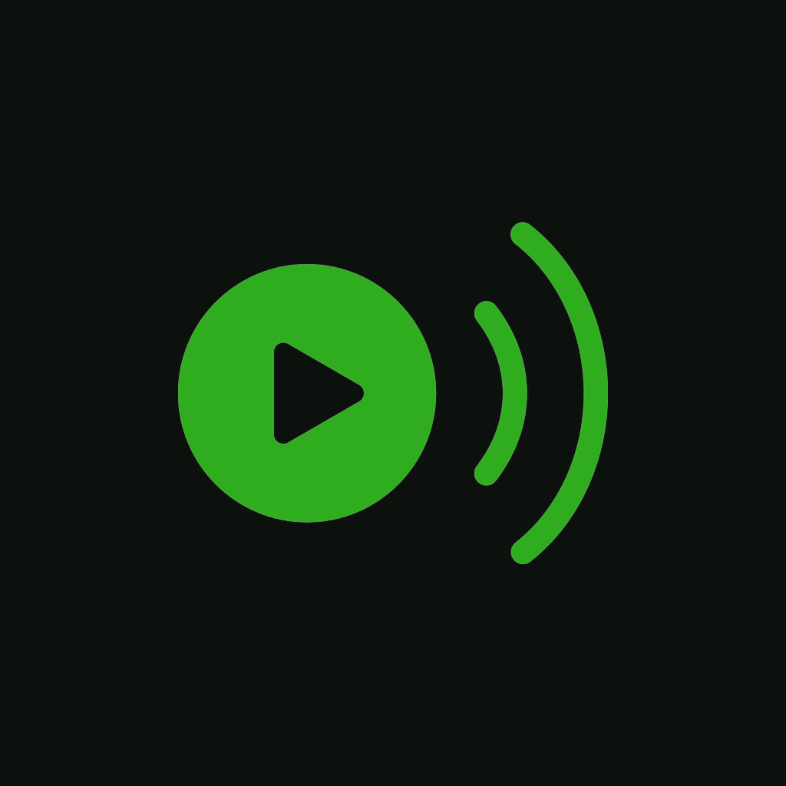

<p align="center">
  
</p>

<h1 align="center">NevTune+</h1>

<p align="center">
  <strong>Smart music discovery &nbsp;·&nbsp; Immersive playback &nbsp;·&nbsp; Every screen, one experience</strong>
</p>

<p align="center">
  
  
  
  
  
</p>

<p align="center">
  <a href="https://github.com/sachit1751-art/NevTune+/releases/latest">
    
  </a>
  &nbsp;
  <a href="https://github.com/sachit1751-art/NevTune+/issues/new?template=bug_report.yml">
    
  </a>
  &nbsp;
  <a href="https://github.com/sachit1751-art/NevTune+/releases">
    
  </a>
</p>

---

**NevTune+** is an open-source, premium music player and discovery app by **NevanStudio**. Find all your YouTube Music catalog including spotify playlist sync, JioSaavn catalog including sync and many more. Built for Android phones, Android TV, Wear OS, and Windows desktop. It brings together local library playback, streaming discovery, offline downloads, synchronized lyrics, smart playlists, and a polished multi-surface UI that feels at home on every screen.

---

## 📸 Screenshots


<div align="center">

| Home Screen | Now Playing | Lyrics View |
|:-----------:|:-----------:|:-----------:|
|  |  |  |

| Library & Downloads | Search & Explore |
|:-------------------:|:----------------:|
|  |  |

</div>

<div align="center">

**Android TV Experience**


</div>

---

## ✨ Why NevTune+ Tho?

NevTune+ is designed to make music listening effortless and beautiful — no matter on which device you're on. On top of that it brings you a seamless experience with no ads and able to play with device screen off.

- 🎵 **Rich playback** — gapless, crossfade, background, session-restoring
- 🔍 **Smart discovery** — continuous home feed, search, moods, radios, and more
- 📥 **Offline-first** — download tracks, albums, and playlists for local playback
- 🎤 **Synchronized lyrics** — real-time lyric-seeking across multiple providers
- 📺 **Every screen** — phone, TV, Wear OS, and Windows desktop
- 🎛️ **Power user controls** — equalizer, loudness normalization, sleep timer, speed control, silence skipping
- 👥 **Listen Together** — party sync to listen in real-time with friends
- 📊 **Listening stats** — personal insights and listening history

---

## 🎯 Features

### 🎧 Playback & Audio Engine

| Feature | Details |
|---------|---------|
| Background playback | Persistent media session with notification controls |
| Gapless & Crossfade | Smooth transitions with adjustable crossfade duration |
| Equalizer | Custom EQ bands with per-output profiles |
| Loudness normalization | Per-track gain correction |
| Spatial audio | Processor-level spatial mixing |
| Sleep timer | Auto-pause after a set duration |
| Playback speed | 0.5× – 2.0× with pitch correction |
| Silence skipping | Automatic silence detection and jump |
| Audio quality | Stream quality selection per network type |
| Format support | FLAC, ALAC, AAC, Opus, MP3, Dolby (via FFmpeg), DTS, HLS, DASH |
| Output routing | Speaker, headphones, Bluetooth, Cast, and remote targets |

### 🔍 Discovery & Library

- **Home feed** — personalized shelves with infinite continuation
- **Search** — songs, albums, artists, playlists, podcasts, and profiles
- **Explore** — moods, genres, trending, new releases, and curated mixes
- **Radio** — artist radio and song-seeded stations
- **Library** — local audio files, downloads, favorites, and playlists
- **Smart Playlists** — auto-generated from history, favorites, and listening patterns
- **Explicit content filter** — toggle `E`-labeled content visibility globally

### 🎤 Lyrics

- Synchronized (LRC) and timed lyrics from multiple providers
- Lyric seeking — tap any line to jump to that moment
- Providers: LRCLib, YouTube Music, Genius, Kugou, Unison, Apple, BiniLyrics, BetterLyrics, and more

### 📱 Multi-Surface Experience

| Surface | Description |
|---------|-------------|
| **Android Phone / Tablet** | Full-featured primary app — `minSdk 26`, `targetSdk 36` |
| **Android TV / Google TV** | 10-foot leanback UI with D-pad navigation |
| **Wear OS** | Companion app — delivered directly from the phone APK |
| **Windows Desktop** | Native desktop client for PC listeners |

### 🌐 Integrations

| Integration | Features |
|------------|---------|
| **YouTube Music** | Stream, search, library sync via InnerTubeX |
| **Spotify** | Playlist import, Canvas artwork, search |
| **JioSaavn** | Catalogue and streaming support |
| **Last.fm** | Scrobbling with API key configuration |
| **Discord** | Rich Presence status updates |
| **Google Cast** | Cast audio to Chromecast / Google Home |
| **SMB / WebDAV** | Stream from local network shares |

---

## 🏗️ Project Structure

```
nevtune_plus1.0.0/
├── app/              # Primary Android application
│   ├── src/main/java/com/nevanstudio/nevtuneplus/
│   │   ├── auth/         # Authentication & sessions (YT Music, Spotify, Discord)
│   │   ├── data/         # Innertube, Spotify, Lyrics, Scrobbling, Stats
│   │   ├── download/     # Offline downloads, FLAC/MP4/WebM tagging
│   │   ├── playback/     # ExoPlayer pipeline, Cast, DSD, Smart playback
│   │   └── ui/           # Compose screens, player, navigation, theming
├── tv/               # Android TV / Google TV surface
├── wearos/           # Wear OS companion app
├── shared/           # Shared Kotlin Multiplatform business logic
├── sharedUi/         # Shared Compose UI foundations & design system
├── desktop/          # Windows desktop client
├── web/              # Web workstream & InnerTube fixtures
├── backend/          # Server-side sync infrastructure
├── native/           # FFmpeg (librempeg) & native audio components
├── docs/             # Design, architecture, and product documentation
└── plans/            # Roadmap and planning documents
```

---

## 🛠️ Tech Stack

<div align="center">

| Layer | Technology |
|-------|-----------|
| **Language** | Kotlin 2.4 |
| **UI** | Jetpack Compose · Material 3 · Compose BOM 2026.09 |
| **Architecture** | MVVM · Clean Architecture · Kotlin Coroutines & Flow |
| **Multiplatform** | Kotlin Multiplatform (KMP) for shared modules |
| **Media** | Media3 / ExoPlayer 1.11 · FFmpeg (librempeg) · HLS · DASH |
| **Networking** | OkHttp · Ktor 3.6 · kotlinx.serialization |
| **Images** | Coil 3 · Palette · SVG |
| **Local Storage** | Room 2.8 · EncryptedSharedPreferences |
| **Background Work** | WorkManager |
| **Blur / Glass** | Haze (Telegram-style progressive blur) |
| **Stream Extraction** | NewPipeExtractor v0.26.3 · InnerTubeX |
| **JavaScript VM** | QuickJS for style/plugin sources · Rhino for YouTube JS |
| **ML / AI** | ONNX Runtime 1.31 (Beat This! automix model) |
| **Casting** | Google Cast SDK · MediaRouter |
| **Network Shares** | SMBJ 0.15 (SMB2/3) |
| **Wear** | Wearable Data Layer API · libadb-android |
| **Build** | AGP 9.3 · Gradle Kotlin DSL · R8 / ProGuard |

</div>

---

## 🚀 Getting Started

### Prerequisites

| Requirement | Version |
|------------|---------|
| Android Studio | Latest stable (Meerkat or newer) |
| JDK | 21 |
| Android SDK | Configured for API 26–37 |
| CMake | 3.22.1 (for native FFmpeg module) |

### Clone & Build

```bash
# Clone the repository
git clone https://github.com/sachit1751-art/NevTune+.git
cd nevtune_plus1.9.1

# Debug build (phone)
./gradlew assembleDevDebug

# Release build (phone)
./gradlew assembleProdRelease

# Android TV
./gradlew :tv:assembleProdRelease

# Wear OS
./gradlew :wearos:assembleProdRelease
```

### Optional: Local Secrets

Create a `local.properties` file in the project root for optional integrations:

```properties
# Last.fm scrobbling (optional)
LASTFM_API_KEY=your_key_here
LASTFM_SECRET=your_secret_here

# Listen Together server (optional — defaults to public server)
LISTEN_TOGETHER_SERVER=https://your-server.example.com
```

### Run in Android Studio

1. Open the project root in Android Studio
2. Select a run configuration from the toolbar:
   - **Phone / Tablet** → `app`
   - **Android TV** → `tv`
   - **Wear OS** → `wearos`
3. Choose your emulator or connected device and press **▶ Run**

> **Tip:** For faster debug installs, run `./gradlew installDevDebug` — the `verifyDevInstall` task auto-runs ART pre-verification, cutting cold-start time significantly.

---

## 📦 Download

| Platform | Download |
|----------|---------|
| Android Phone / Tablet (Universal) | `NevTune+-1.9.1.apk` |
| Android Phone / Tablet (ARM64) | `NevTune+-1.9.1_arm64-v8a.apk` |
| Android TV / Google TV | `NevTunePlusTV-1.9.1.apk` |
| Wear OS | `NevTunePlusWear-prod-universal-release.apk` |
| Windows x64 | `NevTune+-Setup.exe` |

> All releases: [github.com/sachit1751-art/NevTune+/releases](https://github.com/sachit1751-art/NevTune+/releases)

---

## 🗺️ Roadmap

Planned improvements and features on the horizon:

- [ ] Smarter listening recommendations powered by on-device ML
- [ ] Advanced search filters (year, BPM, key, duration)
- [ ] Deeper listening statistics dashboards
- [ ] Podcast and audiobook workflows
- [ ] Expanded local metadata intelligence
- [ ] App-wide accessibility (TalkBack, large text, reduced motion)
- [ ] macOS and Linux desktop builds
- [ ] Additional lyric providers and karaoke mode

---

## 🤝 Contributing

Contributions, bug reports, and feature suggestions are welcome!

- 🐛 **Bug report:** [Open an issue](https://github.com/sachit1751-art/NevTune+/issues/new?template=bug_report.yml)
- 💬 **Feedback:** [General tester feedback](https://github.com/sachit1751-art/NevTune+/issues/new?template=tester-feedback.yml)
- 📖 **Documentation:** See [`docs/`](./docs/) and [`plans/`](./plans/) for architecture and design notes

Please read the [Code of Conduct](./CODE_OF_CONDUCT.md) before contributing.

---

## 📄 License

NevTune+ is open-source software licensed under the **GNU General Public License v3.0**.

```
Copyright © 2026 NevanStudio. All rights reserved.

This program is free software: you can redistribute it and/or modify it
under the terms of the GNU General Public License as published by the
Free Software Foundation, either version 3 of the License, or (at your
option) any later version.
```

See the full [LICENSE](./LICENSE) file for details.

---

## 👨‍💻 Developer

<p align="center">
  <strong>NevTune+ is designed and developed by <a href="https://github.com/sachit1751-art">NevanStudio</a></strong><br/>
  <em>Built for music lovers. Designed to feel at home on every screen.</em>
</p>

<p align="center">
  
</p>
